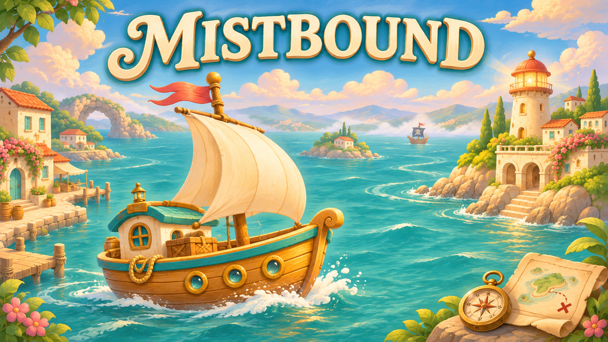

# Mistbound

A cozy sailing puzzle across 20 islands.

[Play in your browser](https://eric-schecter.github.io/mistbound/)

## How to Play

- **Arrow keys / WASD:** Sail until the next obstacle.
- **Swipe:** Sail in the swipe direction on touch screens.
- Collect three chart pieces and reach the lighthouse.
- Ride currents, break driftwood, and avoid reefs and pirate firing lanes.
- Ram pirates from a safe side to clear the route.
- **R:** Retry the current island.
- **M:** Toggle sound.
- **Tab:** Select unlocked islands.

## Development

Open `project.godot` in Godot 4.7.2. Run `sh tools/export_web.sh` to build the web edition in `build/web`.

See [development notes](docs/DEVELOPMENT.md) for structure and checks. Art and cover were generated with AI; sailing audio was generated with ElevenLabs. Music and other sound effects are synthesized locally.
